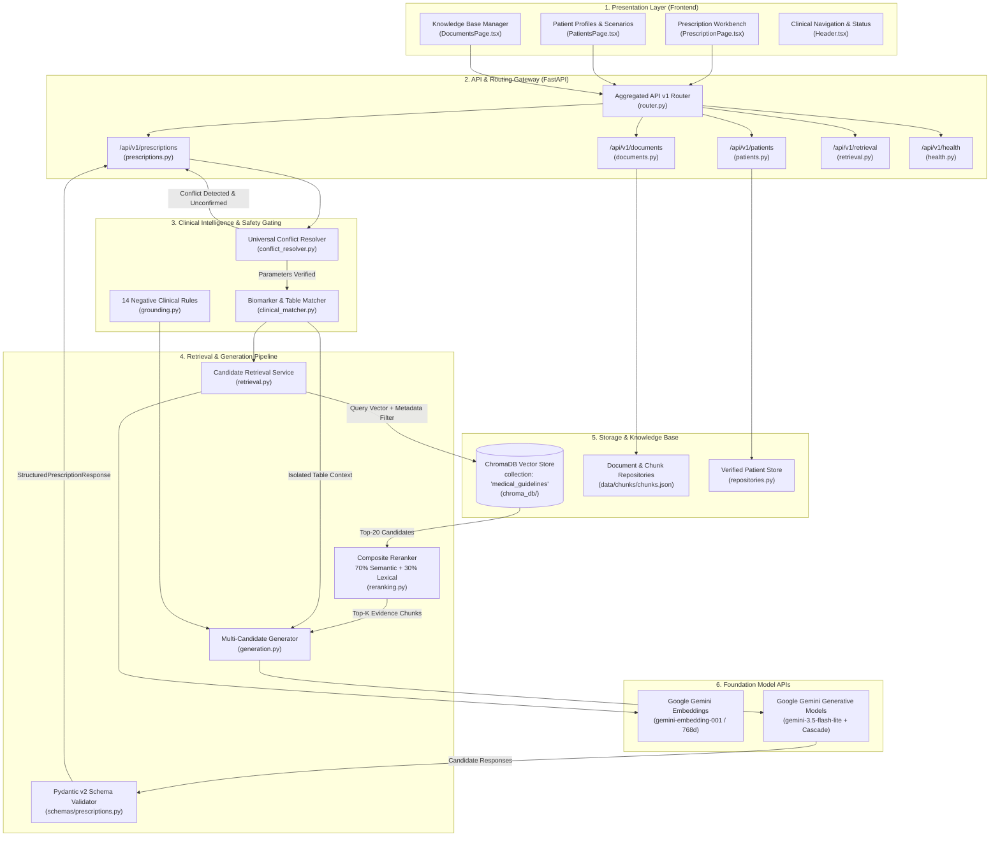
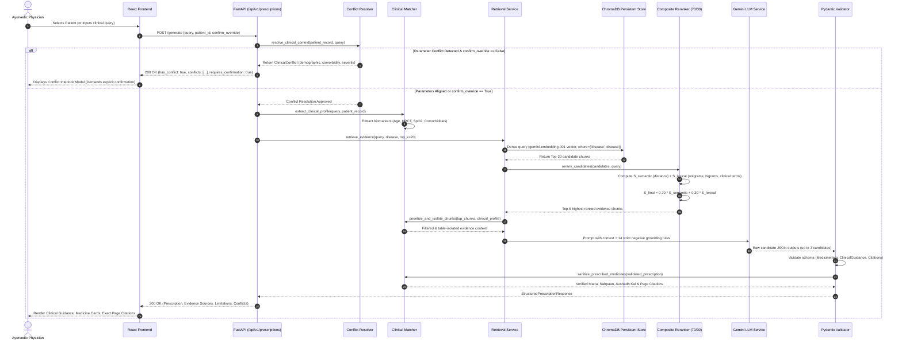
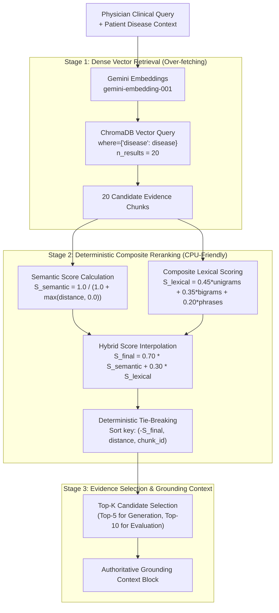
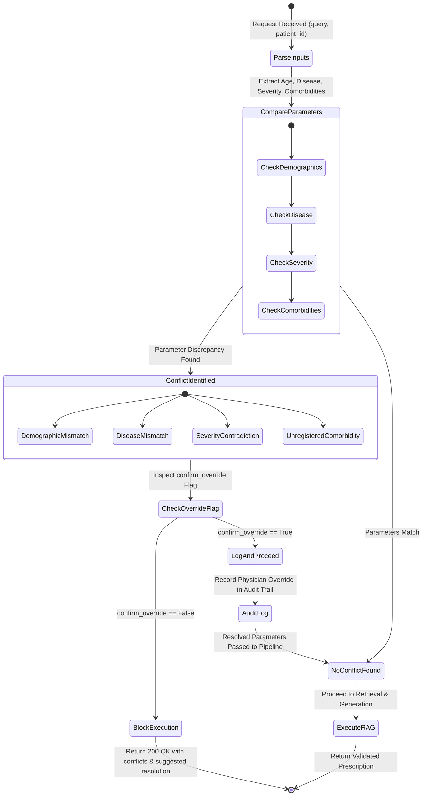
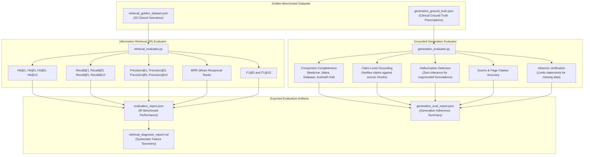

# System Architecture: Grounded Ayurvedic Clinical Prescription RAG

This document details the end-to-end system architecture of the **Ayurvedic Clinical Prescription RAG** platform. The system is designed to provide registered Ayurvedic physicians with clinical decision support and strictly grounded prescription formulation derived from verified medical guidelines, with zero tolerance for clinical hallucinations.

---

## 1. High-Level System Architecture

The system follows a modular architecture separating presentation, API routing, safety verification, retrieval, grounded LLM generation, and persistent vector storage.



---

## 2. End-to-End Clinical Prescription Lifecycle

This diagram illustrates the clinical dataflow from physician interaction to validated prescription delivery, including safety gating and grounded generation.



---

## 3. Document Ingestion & Knowledge Indexing Pipeline

The offline and asynchronous guideline ingestion pipeline transforms heterogeneous clinical documents into persistent, structured vector embeddings while preserving physical page provenance.

```mermaid
flowchart LR
    subgraph InputStage ["1. Document Ingestion"]
        DocPDF["Clinical Guideline PDF<br/>(Respiratory Protocol)"]
        DocDOCX["Clinical Guideline DOCX<br/>(DM RR.docx)"]
    end

    subgraph PreprocessingStage ["2. Preprocessing & Extraction"]
        LibreOffice["Headless LibreOffice<br/>(soffice --convert-to pdf)"]
        Docling["Docling Parser<br/>(DocumentConverter)"]
        ProvTracker["Physical Page Provenance<br/>(item.prov.page_no -> markers)"]
        TableExtractor["Tabular Matrix Parser<br/>(DataFrames with headers)"]
    end

    subgraph ChunkingStage ["3. Structure-Aware Chunking"]
        HeadingSplitter["Section & Subsection Splitter"]
        TableRowChunker["Table Row Splitter<br/>(Preserves Column Headers)"]
        BreadcrumbInjector["Breadcrumb Prepending<br/>[Doc > Section > Subsection]"]
        BoilerplateCleaner["Boilerplate & Noise Filter<br/>(Strips repetitive disclaimers)"]
        HashIdGen["Deterministic ID Generator<br/>(DOC-hash-index-contenthash)"]
    end

    subgraph IndexingStage ["4. Storage & Vector Indexing"]
        JSONOutput[("Structured JSON Files<br/>chunks.json & chunk_summary.json")]
        EmbedAPI["Google GenAI Embeddings<br/>gemini-embedding-001 (768d)"]
        ChromaStore[("Persistent ChromaDB<br/>collection: medical_guidelines")]
    end

    DocDOCX --> LibreOffice
    LibreOffice --> DocPDF
    DocPDF --> Docling

    Docling --> ProvTracker
    Docling --> TableExtractor

    ProvTracker --> HeadingSplitter
    TableExtractor --> TableRowChunker

    HeadingSplitter --> BreadcrumbInjector
    TableRowChunker --> BreadcrumbInjector
    BreadcrumbInjector --> BoilerplateCleaner
    BoilerplateCleaner --> HashIdGen

    HashIdGen --> JSONOutput
    JSONOutput --> EmbedAPI
    EmbedAPI --> ChromaStore
```



---

## 4. Two-Stage Hybrid Retrieval & Reranking Architecture

The retrieval system addresses the *"semantic sponge"* vulnerability (where short section titles or repetitive footers outrank dense informational tables in pure bi-encoder dense space) by utilizing a two-stage hybrid retrieval strategy.



### Reranking Scoring Formulas

$$\text{Semantic Score} = \frac{1.0}{1.0 + \max(\text{cosine\_distance}, 0.0)}$$

$$\text{Lexical Score} = 0.45 \cdot \text{Unigram Overlap} + 0.35 \cdot \text{Bigram Overlap} + 0.20 \cdot \text{Clinical Phrase Matches}$$

$$\text{Final Score} = 0.70 \cdot \text{Semantic Score} + 0.30 \cdot \text{Lexical Score}$$

*Benchmark Performance*: Achieved **100% Hit@5**, **100% Recall@5**, and **1.0000 MRR** across the 20 benchmark clinical scenarios with sub-5ms CPU latency.

---

## 5. Universal Clinical Conflict Detection & Safety Gating

The conflict engine prevents medical hallucination or silent profile overwrites by treating registered patient profiles as authoritative for patient demographics while treating the physician query as the desired presentation.



---

## 6. Evaluation & Benchmarking Architecture

The project features automated, deterministic evaluation pipelines for both Information Retrieval (IR) and Grounded Generation, without reliance on subjective LLM-as-a-judge scoring.



---

## 7. Component & Directory Mapping

The table below maps each architectural layer to its corresponding codebase implementation, technologies, and responsibilities.

| Layer | Codebase Location | Primary Technologies | Key Responsibilities |
|---|---|---|---|
| **Presentation (UI)** | [`frontend/src/`](file:///c:/Users/Sujal Papalkar/Desktop/prescription/frontend/src) | React 19, TypeScript, Vite, Tailwind/Vanilla CSS | Physician prescription workbench, patient profile picker, document management, and evaluation dashboard. |
| **API Gateway** | [`backend/app/api/v1/`](file:///c:/Users/Sujal Papalkar/Desktop/prescription/backend/app/api/v1) | FastAPI, Pydantic v2, Uvicorn | REST routing for `/prescriptions`, `/patients`, `/documents`, `/retrieval`, and `/health`. |
| **Configuration** | [`backend/app/core/config.py`](file:///c:/Users/Sujal Papalkar/Desktop/prescription/backend/app/core/config.py) | Pydantic Settings, `python-dotenv` | Centralized absolute filesystem path resolution and environment variable management. |
| **Document Processing** | [`backend/app/rag/extraction.py`](file:///c:/Users/Sujal Papalkar/Desktop/prescription/backend/app/rag/extraction.py) | Docling, LibreOffice headless | High-fidelity extraction of PDF and DOCX guidelines with bounding box page provenance. |
| **Structure Chunking** | [`backend/app/rag/chunking.py`](file:///c:/Users/Sujal Papalkar/Desktop/prescription/backend/app/rag/chunking.py) | Python regex, `hashlib` | Structure-aware chunking preserving tables, prepending breadcrumbs, and filtering boilerplate. |
| **Vector Storage** | [`backend/app/database/connection.py`](file:///c:/Users/Sujal Papalkar/Desktop/prescription/backend/app/database/connection.py) | ChromaDB PersistentClient | Singleton management for persistent vector collection `medical_guidelines`. |
| **Retrieval Service** | [`backend/app/rag/retrieval.py`](file:///c:/Users/Sujal Papalkar/Desktop/prescription/backend/app/rag/retrieval.py) | Google GenAI SDK (`gemini-embedding-001`) | Query embedding, over-fetched Top-20 vector search, disease partition filtering. |
| **Composite Reranker** | [`backend/app/rag/reranking.py`](file:///c:/Users/Sujal Papalkar/Desktop/prescription/backend/app/rag/reranking.py) | Rank-BM25, Python Standard Math | 70% Semantic + 30% Lexical scoring with deterministic tie-breaking. |
| **Clinical Matcher** | [`backend/app/rag/clinical_matcher.py`](file:///c:/Users/Sujal Papalkar/Desktop/prescription/backend/app/rag/clinical_matcher.py) | Regular Expressions, Dataclasses | Objective biomarker parsing (SpO2, HRCT, Age), table isolation, and medicine sanitization. |
| **Conflict Resolver** | [`backend/app/rag/conflict_resolver.py`](file:///c:/Users/Sujal Papalkar/Desktop/prescription/backend/app/rag/conflict_resolver.py) | Pydantic v2 | Universal clinical parameter conflict detection and physician confirmation gating. |
| **Grounded Generation** | [`backend/app/rag/generation.py`](file:///c:/Users/Sujal Papalkar/Desktop/prescription/backend/app/rag/generation.py) | Gemini GenAI API (`gemini-3.5-flash-lite`) | Multi-candidate LLM generation with exponential backoff and model fallback cascade. |
| **Grounding Rules** | [`backend/app/rag/grounding.py`](file:///c:/Users/Sujal Papalkar/Desktop/prescription/backend/app/rag/grounding.py) | Prompt Engineering | 14 strict negative clinical constraints preventing medical hallucination. |
| **Evaluation Suite** | [`backend/evaluation/`](file:///c:/Users/Sujal Papalkar/Desktop/prescription/backend/evaluation) | Custom Python evaluators, JSON datasets | Deterministic IR metrics (Recall, Precision, Hit, MRR) and claim-level generation evaluation. |

---

## 8. Technology Stack Summary

```
+-----------------------------------------------------------------------------------------+
|                                    TECHNOLOGY STACK                                     |
+-------------------+---------------------------------------------------------------------+
| Frontend          | React 19.2, TypeScript 6, Vite 8, Lucide React, Oxlint, Vanilla CSS |
| Backend API       | Python 3.10+, FastAPI 0.110+, Uvicorn 0.28+, Pydantic v2 2.6+       |
| Document Parsing  | Docling 2.0+, LibreOffice (soffice headless), pandas                |
| Vector Store      | ChromaDB 0.4.22+ (Persistent embedded storage)                      |
| Embedding Model   | Google GenAI gemini-embedding-001 (768 dimensions)                  |
| Generation Models | Google GenAI gemini-3.5-flash-lite (Primary)                        |
|                   | Fallbacks: gemini-3.8-flash, gemini-3.7-flash, gemini-3.1-flash-lite|
| Lexical Search    | Rank-BM25 (BM25Okapi with unigram/bigram tokenization)              |
| Testing & Bench   | Python unittest, custom deterministic IR & claim-level evaluators   |
+-------------------+---------------------------------------------------------------------+
```
